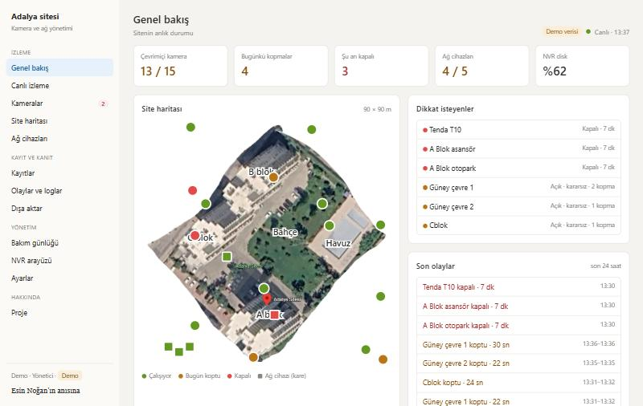
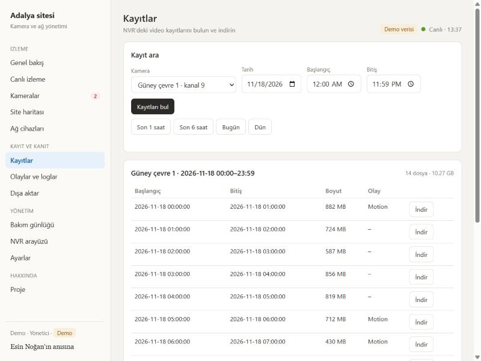
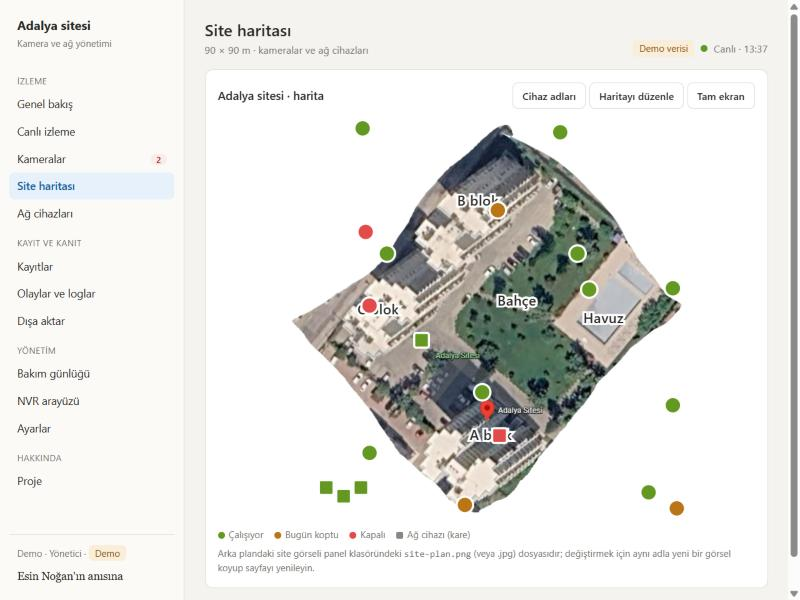
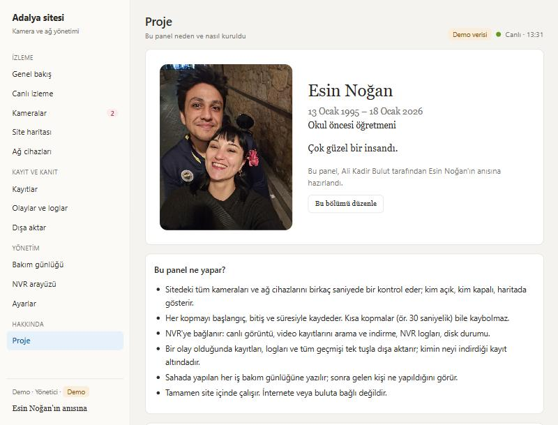

# Adalya Paneli

**A local management site for the cameras and network of Adalya Sitesi.**
Live view, recordings, drop history, logs, exports, maintenance notes and a site map, all in one place, running entirely inside the site's own network.

<p align="center">
  
</p>

<p align="center">
  <b>Esin Noğan'ın anısına</b><br>
  13 Ocak 1995 – 18 Ocak 2026 · Okul öncesi öğretmeni<br>
  <i>Çok güzel bir insandı.</i><br><br>
  This project was built by Ali Kadir Bulut in memory of Esin.
</p>

---

## Contents

1. [What it is](#what-it-is)
2. [Why it exists](#why-it-exists)
3. [Screenshots](#screenshots)
4. [Features, page by page](#features-page-by-page)
5. [How it works](#how-it-works)
6. [Quick start (demo)](#quick-start-demo)
7. [Running it on site](#running-it-on-site)
8. [Users and roles](#users-and-roles)
9. [If something happens: getting recordings and logs](#if-something-happens-getting-recordings-and-logs)
10. [Editing the map](#editing-the-map)
11. [Editing the memorial section](#editing-the-memorial-section)
12. [Configuration files](#configuration-files)
13. [Command-line options](#command-line-options)
14. [Site test toolkit](#site-test-toolkit)
15. [Security and privacy (KVKK)](#security-and-privacy-kvkk)
16. [Troubleshooting](#troubleshooting)
17. [Project status](#project-status)
18. [Files in this repository](#files-in-this-repository)

---

## What it is

Adalya Paneli is a small web application written in Python using only the standard library, with no packages to install. It runs on one computer inside the site and everyone else opens it in a browser. The interface is in Turkish.

It does five things:

- **Watches** every camera and network device every few seconds and shows who is up, who is down, and where they are on a map of the site.
- **Records every drop** with its start, end and duration, including short ones like 30-second Wi-Fi dropouts.
- **Connects to the Dahua NVR** for live pictures, recording search and download, NVR logs and disk status.
- **Exports evidence** with one click: drop history, NVR logs, maintenance notes and device status in one zip, plus every download logged with who and when.
- **Keeps a maintenance log**, so the next person knows what was done.

## Why it exists

After the previous service provider stopped supporting the site, several of the 24 cameras started going black on the recorder's screen. The investigation showed the cameras weren't broken; the network was:

- The router handed cameras **temporary addresses** that kept changing, while the recorder looked for each camera at a fixed address. Every change made a working camera disappear.
- Some cameras were still on an **old address range** (`192.168.1.x`) from a previous setup and couldn't be reached at all.
- Far cameras were connected through **weak Wi-Fi and consumer range extenders**, which caused 20–40 second dropouts.

The addressing was fixed (DHCP pool moved to `.150–.200`, cameras pinned to their addresses by MAC), and this panel was built so the site can see problems as they happen and pull evidence when it matters.

## Screenshots

| | |
|---|---|
|  **Genel bakış** · status, map, alerts, recent drops |  **Canlı izleme** · picture from every camera |
|  **Kayıtlar** · find and download recordings |  **Site haritası** · cameras on the aerial view |
|  **Proje** · the memorial and the story of the project | |

*Screenshots are from demo mode, so the camera pictures are simulated.*

## Features, page by page

The menu on the left is grouped into four sections.

### İzleme (monitoring)

| Page | What you get |
|---|---|
| **Genel bakış** | Cameras online, drops today, devices down, network devices, NVR disk. Mini map, list of devices that need attention, recent drops, shortcuts for "something happened". |
| **Canlı izleme** | A tile per camera with the NVR's latest picture, refreshed every few seconds. Click a tile to enlarge it (refreshes about every 1.5 s) and jump to its recordings. |
| **Kameralar** | Every device with its NVR channel, IP, status, ping, drops today, 24-hour uptime and MAC check ("Eşleşiyor" or "Farklı cihaz"). Click a row for the detail view: latest picture, a 24-hour strip with each drop marked in red, maintenance notes, and buttons for live view and recordings. |
| **Site haritası** | Full-screen map on the site's aerial image, with A/B/C blok labels. Pins are green (working), amber (dropped today) or red (down). Admins can drag pins and labels into place. |
| **Ağ cihazları** | Router, switch, NVR and Wi-Fi devices with links to their own web pages, and a plain-language description of the network. |

### Kayıt ve kanıt (recordings and evidence)

| Page | What you get |
|---|---|
| **Kayıtlar** | Pick a camera, date and time range (or "Son 1 saat", "Son 6 saat", "Bugün", "Dün"). Lists the NVR's recording files with size and events. **İndir** downloads a file. |
| **Olaylar ve loglar** | The panel's own drop history for any date range, and the NVR's own logs (logins, video loss, reboots, disk). Both export to CSV. |
| **Dışa aktar** | **Full package (zip)** for the last 1/7/30/90 days, quick CSV exports, and the **download log**: who downloaded what and when (admins only). |

### Yönetim (management)

| Page | What you get |
|---|---|
| **Bakım günlüğü** | Notes on what was done on site, by whom and when, optionally attached to a device. |
| **NVR arayüzü** | The Dahua NVR's own web interface inside the panel, with an "open in new tab" button for NVR firmware that refuses to be embedded. |
| **Ayarlar** | NVR connection, user accounts, the memorial section (text and photo), site name, support contact, map labels, and your own password. |

### Hakkında (about)

| Page | What you get |
|---|---|
| **Proje** | The memorial for Esin Noğan, what the panel does, what went wrong and what was done, a step-by-step "if something happens" guide, and the privacy notice. |

## How it works

```
                Internet
                   │
        Router TP-Link EX520v (192.168.0.1)  ── DHCP, Wi-Fi channel 11
                   │
        Switch Ruijie RG-ES208GC (192.168.0.16)
           │                    │
  NVR Dahua NVR4232-4KS3   Panel PC (192.168.0.30)  ← adalya_panel.py --lan
   (192.168.0.23) ── HDMI ── monitor        │
           ▲                                │ ping, ARP, Dahua HTTP API
           │ video                          │
   Cameras DH-P3B-PV (Wi-Fi, some through range extenders)
                                            │
            Browsers: watchman phone, manager laptop, security room screen
```

- **Monitoring:** every 2 seconds the panel pings every device in `devices.json`. A device counts as down after 2 missed pings; when it comes back, the drop is saved with its duration. Every 60 seconds it reads the ARP table and checks each IP still belongs to the expected MAC.
- **NVR:** the panel talks to the NVR over its HTTP API (digest login): device info, disks, channel names, snapshots, recording search (`mediaFileFind`), file download (`RPC_Loadfile`) and logs (`log.cgi`). Every call makes exactly **one** login attempt; if the NVR refuses, the panel stops talking to it so the NVR account can never get locked.
- **Storage:** SQLite (`data/panel.db`) for drops, notes and the download log; JSON files for users, devices, map and memorial.
- **Frontend:** one HTML file (`panel.html`) with plain JavaScript. It works in any modern browser, on phones too, and follows the device's light or dark mode.

## Quick start (demo)

Try every page on your own computer with a simulated site and NVR:

```bash
python adalya_panel.py --demo
```

It opens `http://127.0.0.1:8080`. The demo needs no login, makes a few cameras drop now and then like the real problem, and keeps its data separate in `data-demo/`.

Requirements: Python 3.9 or newer. Nothing else.

## Running it on site

The short version (full guide: [INSTALL.md](INSTALL.md)):

1. Put the panel on **one always-on computer** in the security room, wired to the switch and on the UPS.
2. Give it a fixed address (`192.168.0.30`) with a DHCP reservation on the router.
3. Start it with `start-panel.bat` (or `python adalya_panel.py --lan`). Allow Python through Windows Firewall on private networks.
4. Open `http://127.0.0.1:8080` on that computer and **create the first admin account**.
5. **Ayarlar → NVR bağlantısı**: enter the NVR address, user and password. The password is never saved, so reconnect after each restart.
6. **Ayarlar → Kullanıcılar**: create an account for each person.
7. Everyone else opens **`http://192.168.0.30:8080`** in their browser on the site network.
8. Put a shortcut to `start-panel.bat` in the Windows Startup folder (`Win+R` → `shell:startup`) so it starts with the computer.

Don't install a separate copy on each person's device. One panel means one history, one download log and one NVR connection.

## Users and roles

Everyone logs in with their **own username and password**. Their name appears in the download log.

| Role | Can do |
|---|---|
| **Görevli** (watchman, security staff) | Live view, cameras, map, recordings search and download, logs, exports, maintenance notes, change own password |
| **Yönetici** (admin) | Everything above, plus NVR connection, users, memorial section, map editing, labels, site settings, and the download log |

- Usernames: lowercase letters, digits, dot, dash (e.g. `ahmet.bekci`). Passwords: at least 8 characters.
- Resetting someone's password logs them out everywhere. You can't delete your own account or remove the last admin.
- After 5 wrong passwords, logins pause for 30 seconds.

## If something happens: getting recordings and logs

1. **Genel bakış**: which camera is down, and since when?
2. **Olaylar ve loglar**: find the time range of the incident (panel drops and NVR logs).
3. **Kayıtlar**: choose the camera and time, then **İndir** the files. They are Dahua `.dav` files; open them with **Dahua SmartPlayer** (VLC plays most of them).
4. **Dışa aktar → Tam paket**: download the zip covering those days. It contains:

| File | Content |
|---|---|
| `olaylar.csv` | Every drop: device, IP, start, back, seconds |
| `nvr-log.csv` | NVR logs for the period (if the NVR is connected) |
| `bakim-notlari.csv` | Maintenance notes |
| `cihaz-durumu.csv` | Status of every device at export time |
| `disa-aktarim-kaydi.csv` | Who exported or downloaded what |
| `devices.json`, `nvr-bilgi.json` | Inventory and NVR details |
| `BENI-OKU.txt` | Who made the package, when, and what it covers |

5. Write what you did in **Bakım günlüğü**.

> Don't reset or reconfigure the router, NVR or switch. The camera addresses depend on their settings, and a reset makes cameras drop again.

## Editing the map

- The background is `site-plan.png` (or `.jpg` / `.webp`) in the panel folder. To change it, save a new image with the same name and refresh. The map adapts to the image's proportions.
- **Site haritası → Haritayı düzenle** (admins): drag cameras, network devices and labels to their real positions. Positions save automatically: devices to `devices.json`, labels to `site.json`.
- **Ayarlar → Site ve harita**: rename, add or remove labels (A blok, B blok, C blok, Bahçe, Havuz…).
- **Cihaz adları** shows or hides device names; **Tam ekran** makes the map fill the screen.

## Editing the memorial section

**Ayarlar → Anma bölümü** (admins): name, birth and death dates, profession, the note, who prepared the panel, and the photo. Upload a JPG, PNG or WEBP (up to 8 MB), then use the two sliders to choose which part of the photo shows in the frame. The text appears on the **Proje** page, at the bottom of the menu, and on the login screen. The panel forms the Turkish possessive correctly for any name (Esin Noğan'**ın**, Ayşe'**nin**, Gül'**ün**).

## Configuration files

### `devices.json`: what the panel watches

One object per device:

```json
{"name": "Güney çevre 1", "ip": "192.168.0.106", "mac": "E0:2E:FE:67:B9:C9",
 "type": "camera", "channel": 9, "x": 40, "y": 88}
```

| Field | Meaning |
|---|---|
| `name` | Shown everywhere in the panel |
| `ip` | Address to ping |
| `mac` | Expected MAC; if a different device answers on that IP the panel shows "Farklı cihaz" |
| `type` | `camera`, `nvr`, `router`, `switch`, `repeater` or `ap` |
| `channel` | NVR channel number (cameras), used for live view and recordings |
| `x`, `y` | Map position, 0–90 (set by dragging) |
| `hidden` | `true` to watch it without showing it (e.g. old-subnet addresses) |
| `ports` | Ports the site test toolkit checks |

When a camera is added, replaced or moves to a new IP, update this file and restart the panel.

### `site.json`: site name, memorial, map labels

Edited from **Ayarlar**; you rarely need to touch it by hand.

### `data/`: history and accounts

`panel.db` (drops, notes, download log) and `config.json` (users with hashed passwords, last NVR address). **Back this folder up** and never share it.

## Command-line options

| Option | Default | Meaning |
|---|---|---|
| `--demo` | off | Simulated site and NVR, no login, separate data |
| `--lan` | off | Listen on the site network, not just this computer |
| `--port` | `8080` | Web port |
| `--interval` | `2` | Seconds between ping rounds |
| `--misses` | `2` | Missed pings before a device counts as down |
| `--nvr-user` | | Connect to the NVR at start (asks for the password in the console) |
| `--nvr-host` | `192.168.0.23` | NVR address for `--nvr-user` |
| `--no-browser` | off | Don't open a browser window at start |

## Site test toolkit

`adalya_test.py` is a separate command-line tool for site visits. It is read-only and needs only the standard library.

```bash
python adalya_test.py check                      # health check of every device, MAC drift, ports, SNMP
python adalya_test.py watch --only 106,108,12    # ping every second, log each drop with its duration
python adalya_test.py nvr --user admin           # see which NVR API calls work
python adalya_test.py snmp --host 192.168.0.1    # does a device answer SNMP?
```

Results go to `results/` as CSV. The step-by-step site-day checklist is in [TEST-PLAN.md](TEST-PLAN.md).

## Security and privacy (KVKK)

Camera recordings and logs are personal data of residents and visitors.

- Runs **only inside the site network**. No cloud, no internet connection needed.
- Personal accounts; passwords stored as salted PBKDF2 hashes; sessions expire after 12 hours of inactivity.
- **Every download and export is logged** with the person's name and time.
- The **NVR password is never written to disk**.
- Recording downloads are limited to files the NVR returned in a search, and the NVR connection is limited to private addresses.
- Requests from other websites are refused.
- **Never port-forward** the panel or the NVR to the internet. For remote access use a VPN (WireGuard, Tailscale) on the panel computer.
- Share exported files only with authorised people and delete them when done.

## Troubleshooting

| Problem | What to check |
|---|---|
| Page says "Panel sunucusuna ulaşılamıyor" | Is the panel window still running on the panel PC? Same network? Correct address and port? |
| Other devices can't open it | Started with `--lan`? Windows Firewall allowed Python on private networks? |
| A camera shows down but works on the NVR | Its IP may have changed. Check the router's client list and update `devices.json`. |
| "Farklı cihaz" in the MAC column | Another device answers on that IP: an IP conflict or drift. Fix the reservation on the router. |
| Live view tiles say "Görüntü alınamadı" | Is the NVR connected (Ayarlar)? Is snapshot enabled on the NVR? Is the camera itself online? |
| "NVR kullanıcı adını veya şifreyi reddetti" | Wrong NVR user or password. The panel stopped on purpose; correct it and press Bağlan again. |
| NVR disk shows "?" | The NVR answers in a different format; run `python adalya_test.py nvr` and check the saved answers. |
| History has gaps | The panel PC was off or asleep; history only covers the time the panel runs. |
| Downloaded `.dav` won't play | Use Dahua SmartPlayer. |

## Project status

- **Done:** monitoring, drop history, map, recordings, logs, exports, download log, maintenance log, user accounts, memorial section, demo mode, site test toolkit.
- **Tested** against a simulated Dahua NVR: login, snapshots, recording search and download, logs, exports, lockout protection, permissions.
- **Not yet tested against the real NVR** on site; see TEST-PLAN.md step 7.
- **Planned:** automatic discovery of new or moved devices; outdoor access point for the south side; recovery of the cameras still on `192.168.1.x`; long-term cabling.

## Files in this repository

| File | Purpose |
|---|---|
| `adalya_panel.py` | The panel server |
| `panel.html` | The web interface |
| `nvr.py` | Dahua NVR client (and the demo NVR) |
| `adalya_test.py` | Site test toolkit |
| `devices.json` | Watched devices, channels, map positions |
| `site.json` | Site name, memorial section, map labels |
| `site-plan.png` | Map background image |
| `media/` | Memorial photo |
| `start-panel.bat` | Start script for the always-on PC |
| `INSTALL.md` | Installation guide |
| `TEST-PLAN.md` | Site test-day checklist |
| `docs/` | README images |

---

<p align="center"><i>Esin Noğan'ın anısına.</i></p>
