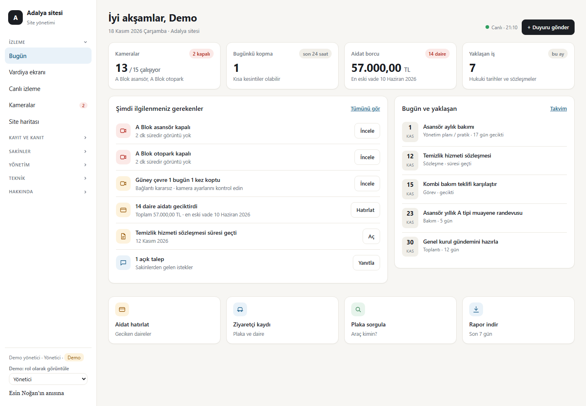
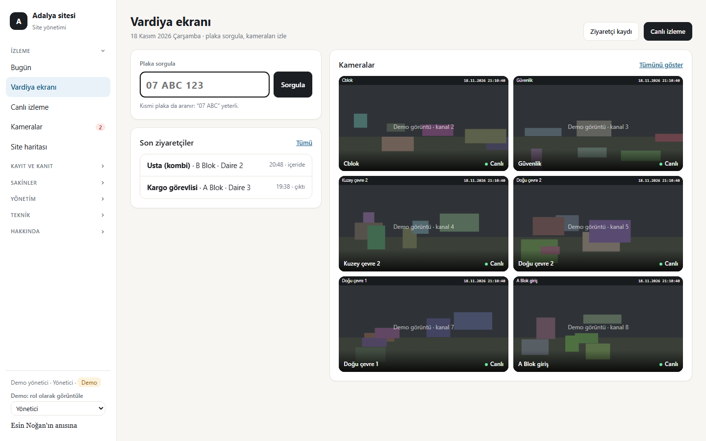
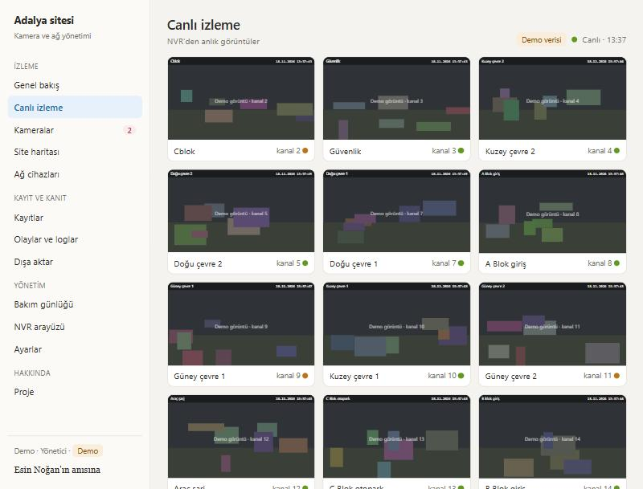
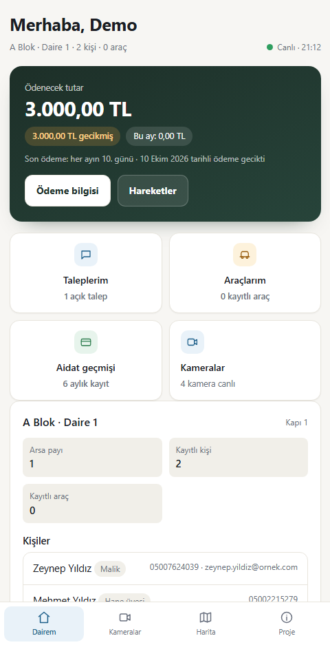

# Adalya Paneli

**A local management site for the cameras and network of Adalya Sitesi.**
Live view, recordings, drop history, logs, exports, maintenance notes and a site map, all in one place, running entirely inside the site's own network.

<p align="center">
  
</p>

<p align="center">
  <b>Esin Noğan'ın anısına</b><br>
  13 Ocak 1995 – 18 Ocak 2026 · Okul öncesi öğretmeni<br>
  <i>Çok güzel bir insandı.</i><br><br>
  This project was built by Ali Kadir Bulut in memory of Esin.
</p>

> **Personal project · All rights reserved.** See [License](#license).

---

## Contents

1. [What it is](#what-it-is)
2. [Why it exists](#why-it-exists)
3. [Screenshots](#screenshots)
4. [Features, page by page](#features-page-by-page)
5. [How it works](#how-it-works)
6. [Quick start (demo)](#quick-start-demo)
7. [Running it on site](#running-it-on-site)
8. [Users and roles](#users-and-roles)
9. [If something happens: getting recordings and logs](#if-something-happens-getting-recordings-and-logs)
10. [Editing the map](#editing-the-map)
11. [Editing the memorial section](#editing-the-memorial-section)
12. [Configuration files](#configuration-files)
13. [Command-line options](#command-line-options)
14. [Site test toolkit](#site-test-toolkit)
15. [Security and privacy (KVKK)](#security-and-privacy-kvkk)
16. [Troubleshooting](#troubleshooting)
17. [Project status](#project-status)
18. [Documents](#documents)
19. [Files in this repository](#files-in-this-repository)
20. [License](#license)

---

## What it is

Adalya Paneli is a small web application written in Python using only the standard library, with no packages to install. It runs on one computer inside the site and everyone else opens it in a browser. The interface is in Turkish.

It does five things:

- **Watches** every camera and network device every few seconds and shows who is up, who is down, and where they are on a map of the site.
- **Records every drop** with its start, end and duration, including short ones like 30-second Wi-Fi dropouts.
- **Connects to the Dahua NVR** for live pictures, recording search and download, NVR logs and disk status.
- **Exports evidence** with one click: drop history, NVR logs, maintenance notes and device status in one zip, plus every download logged with who and when.
- **Keeps a maintenance log**, so the next person knows what was done.

## Why it exists

After the previous service provider stopped supporting the site, several of the 24 cameras started going black on the recorder's screen. The investigation showed the cameras weren't broken; the network was:

- The router handed cameras **temporary addresses** that kept changing, while the recorder looked for each camera at a fixed address. Every change made a working camera disappear.
- Some cameras were still on an **old address range** (`192.168.1.x`) from a previous setup and couldn't be reached at all.
- Far cameras were connected through **weak Wi-Fi and consumer range extenders**, which caused 20–40 second dropouts.

The addressing was fixed (DHCP pool moved to `.150–.200`, cameras pinned to their addresses by MAC), and this panel was built so the site can see problems as they happen and pull evidence when it matters.

## Screenshots

| | |
|---|---|
|  **Bugün** · what needs attention now |  **Vardiya ekranı** · plate lookup and the camera wall |
|  **Canlı izleme** · picture from every camera |  **Site haritası** · cameras on the 3D view of the site |
|  **Dairem** · the resident's phone home |  **Kayıtlar** · find and download recordings |
|  **Proje** · the memorial and the story of the project | |

*Screenshots are from demo mode, so the camera pictures are simulated.*

## Features, page by page

The menu on the left is grouped into eight sections: Sitem (residents only), İzleme, Kayıt ve kanıt, Sakinler, İletişim, Yönetim, Teknik and Hakkında. The active section header is highlighted. A light/dark switch sits at the bottom of the menu (it follows the system until you choose), and **Ara (⌘K / Ctrl+K)** opens a quick search over residents, phones, plates, flats, documents, contracts and announcements. Residents get four large tabs at the bottom on a phone.

### İzleme (monitoring)

| Page | What you get |
|---|---|
| **Bugün** (home) | Answers "what do I do now?" instead of listing the system state. Greeting and date, four plain-language counters (cameras working, drops today, aidat debt, upcoming legal work), **Şimdi ilgilenmeniz gerekenler** — cameras that are down, flats that are overdue, a contract about to expire, a new request — each with one action button, a **Bugün ve yaklaşan** agenda (legal dates, tasks, contracts), and four quick actions. Güvenlik sees cameras, drops and network devices; the aidat and legal cards are admin-only. |
| **Vardiya ekranı** | The guard's screen: a large plate search box with the result card (flat, residents, phones, vehicle), **today's pre-approved visitor passes** with a "Giriş" button, **parcels** waiting for a flat with "Teslim", today's visitors, and a 2 × 3 wall of live snapshots refreshed every 4 seconds. Works for Güvenlik and Yönetici. |
| **Canlı izleme** | A grid of camera tiles that fills the screen, with **8, 16 or 32 views per screen** and paging when there are more cameras (‹ › buttons or the arrow keys). The choice is remembered per browser. **Tam ekran** is meant for the security room monitor. Tiles refresh one at a time (about 1.4 snapshot requests per second in total, never more than 2 open at once), so a bigger grid doesn't load the NVR more. Click a tile to enlarge it (Esc closes) and jump to its recordings. The enlarged view refreshes **continuously**: the next picture is requested as soon as the last one arrives, up to 4 per second, one request at a time, with the actual frame rate shown next to the camera name. The grid pauses meanwhile, so the NVR load stays about the same. It is near-live, not true video (no sound); see "Live video" under Project status. |
| **Kameralar** | Every device with its NVR channel, IP, status, ping, drops today, 24-hour uptime and MAC check ("Eşleşiyor" or "Farklı cihaz"). Click a row for the detail view: latest picture, a 24-hour strip with each drop marked in red, maintenance notes, and buttons for live view and recordings. |
| **Site haritası** | Full-screen map on a 3D render of the site, rotated so B and C blok are at the top, with block labels. Each device has an icon for its type (camera, access point, router, switch, NVR, repeater; cameras round, network devices square) coloured by status: green (working), amber (dropped today), red (down), grey (unknown). Clicking a device opens a small card with name, type, IP, channel, status and buttons for live view and details. Admins can drag pins and labels into place and adjust the image rotation. |
| **Ağ cihazları** | Router, switch, NVR and Wi-Fi devices with links to their own web pages, and a plain-language description of the network. Admins also get the **device inventory**: add, edit or remove cameras and devices (name, IP, MAC, type, NVR channel) without editing `devices.json` by hand, with the step-by-step order for adding a new device (MAC → router reservation below .150 → NVR channel → panel → map). It refuses duplicate IPs and channels and warns about addresses inside the DHCP pool. Only the panel's list changes; the device itself is never touched. |
| **Daireler ve kişiler** | Aidat status per flat with a one-click **Hatırlat** (opens WhatsApp, or e-mail, for the tenant if there is one, otherwise the owner, with the overdue amount, months and IBAN filled in), filters (overdue, has debt, no debt), checkboxes and the same bulk actions as the Aidat page. Flats (blok, kapı, daire, arsa payı), people (malik, kiracı, hane üyesi; phone, e-mail, move-in/out, emergency contact) and vehicles (plate, model, colour, parking spot, sticker). Search by name, phone, plate or flat. Import from **Excel (.xlsx) or CSV** with a preview first; re-importing updates instead of duplicating. Export to CSV. |
| **Ziyaretçi ve araç** | Plate lookup (partial plates work, spaces and case don't matter) showing the flat, residents and phones, plus the visitor log with check-in/out. |
| **Mesaj gönder** | **Reminder queue**: prepare one message per overdue flat (with balance, oldest due date and IBAN), optionally automatic on a chosen day of the month, with a send log ("Bekliyor / Gönderildi / İptal") and a WhatsApp button per row. Then pick recipients (all, owners, tenants, flats with overdue aidat, flats with any debt, the flats selected on another page; per blok) and a template (free text, aidat reminder, second aidat notice, monthly aidat notice, payment thank-you, "confirm your details and vehicles", ordinary general assembly invitation). Placeholders such as {bakiye}, {geciken}, {geciken_donem}, {iban} are filled per flat. The panel fills each person's name, flat, phone and vehicles, then gives a **WhatsApp** button per person (opens the chat with the text; you press send), e-mail (per person or BCC in batches) and **printable letters** with a signature list for legal notice (imza karşılığı, at least 15 days before the meeting). |
| **Talepler** | Requests with a **category** (bakım/onarım, arıza, temizlik, gürültü, araç/otopark, diğer) and an optional **photo** (max 5 MB, admin and owner only — not visible to Güvenlik). Filter by open/closed and category, answer and close. |
| **Duyurular** | Announcement board: the manager publishes a duyuru, arıza/kesinti, toplantı or güvenlik notice, pins the important ones, and sees **how many people read it and who**. Residents see unread items highlighted, press **Okudum**, and get an unread badge in the menu and on their phone tabs. No e-mail or WhatsApp needed for water cuts and elevator outages. |
| **Aidat ve tahsilat** | Monthly aidat per flat (equal, or a monthly total split by arsa payı), created for a month with one click (never twice). Payments (havale, nakit, kart) close the oldest debt first. Shows this month's charges and collections, total receivable, overdue amounts and flats, the oldest due date, and an estimated late fee (KMK 20, up to 5% a month, only calculated, not charged). Full account statement per flat; wrong entries can be deleted (logged). **Makbuz**: a numbered receipt for any payment (year-00001), printable or saved as PDF from the browser; residents see their own receipts. An optional **payment link** (bank/POS) is shown to residents as "Ödeme yap". **Bank statement import**: upload a CSV (tarih, tutar, açıklama), the panel matches rows to flats by plate, name or "A Blok 3", you correct what it missed, then records them as payments. Bulk actions on selected flats: prepare reminders, write a message, mark paid in full, add an extra charge (repair share, late fee). Settings: amount, due day, late-fee rate, the site's bank account (IBAN), payment link. CSV export. |
| **Sakin kamera erişimi** | Master switch (off by default) for residents watching cameras. Default access per column: "Tüm sakinler" (shared areas such as the main gate) and per blok (that blok's entrance, elevator, parking); "Kamera adına göre öner" ticks cameras whose name contains the blok. A flat can get its own list in Daireler ve kişiler → Düzenle. Residents get the live picture only; the first view of each camera per day is logged. |
| **Dairem** (residents) | A phone-first home: greeting, flat chip, one large balance card ("Ödenecek tutar", overdue in amber, IBAN/Ödeme bilgisi and Hareketler buttons), four big tiles (requests, vehicles, aidat history, cameras if allowed), household and vehicles, **guest passes** (name, plate, date and time window — the gate sees them immediately), **parcels** the guard has logged, aidat details and ledger, a form to write to the management, requests with answers, and password change. |

### Kayıt ve kanıt (recordings and evidence)

| Page | What you get |
|---|---|
| **Kayıtlar** | Pick a camera, date and time range (or "Son 1 saat", "Son 6 saat", "Bugün", "Dün"). Lists the NVR's recording files with size and events. **İndir** downloads a file. |
| **Olaylar ve loglar** | The panel's own drop history for any date range, and the NVR's own logs (logins, video loss, reboots, disk). Both export to CSV. |
| **Dışa aktar** | **Full package (zip)** for the last 1/7/30/90 days, quick CSV exports, and the **download log**: who downloaded what and when (admins only), with filters by date, person, action and detail, and **CSV export** of the filtered log (the export itself is logged). |

### Yönetim (management)

| Page | What you get |
|---|---|
| **Takvim ve görevler** | A year calendar of the manager's KMK duties: işletme projesi (KMK 37), genel kurul invitation at least 15 days ahead, ordinary general assembly in January, annual accounts to the kurul (KMK 39), notary closing of the decision book by end of January (KMK 36), year-end cash/bank reconciliation and monthly elevator maintenance. Each duty can be ticked off for the year (or the month). You add your own dated tasks, with one-click templates for the practical yearly duties (elevator A-type inspection, insurance renewal, İSG, fire extinguishers). The page says plainly that it is a helper, **not legal advice**; the yönetim planı and a lawyer have the final word. |
| **İşletme projesi** | KMK 37 builder: yearly income/expense lines, totals, the amount to collect as advance, **per-flat advance by arsa payı**, then "Bildirildi" (starts the 7-day objection window and locks the lines) and "Kesinleştir" (warns if the window is still open). Shows the objection deadline and the per-flat table. A helper, not legal advice. |
| **Gelir-gider** | Income and expenses beyond aidat: date, tür, category (kira, bağış, temizlik, asansör, elektrik, su, personel, bakım, vergi…), explanation, amount, note. Year totals (gelir, gider, net), list with delete, CSV export. All changes logged. |
| **Sözleşmeler ve poliçeler** | Contracts and insurance policies with provider, start/end dates, amount, note and an attached document. Shows valid / expiring within 30 days / expired, with a renewal warning, and feeds the alert card on Bugün. |
| **Belgeler** | Document archive: upload PDF, Word, Excel, images or text (max 10 MB), with category and note; download and delete. Files are kept in `data/belgeler/`, which is part of the `data/` backup. Uploads, downloads and deletions are written to the audit log. Admin only. |
| **Bakım günlüğü** | Notes on what was done on site, by whom and when, optionally attached to a device. |
| **NVR arayüzü** | The Dahua NVR's own web interface inside the panel, with an "open in new tab" button for NVR firmware that refuses to be embedded. |
| **Yedekler** | Daily automatic backup to `data/yedekler/` (hour and how many to keep are configurable), "Şimdi yedek al", download, and a **restore** that first takes a safety backup, then restores the database in place (safe while the panel runs) and reloads devices, site and accounts. Restore needs the typed confirmation GERI YUKLE. |
| **Ayarlar** | NVR connection, user accounts, **two-step login (TOTP)** for the admin account, the memorial section (text and photo), site name, support contact, map labels, and your own password. |

### Hakkında (about)

| Page | What you get |
|---|---|
| **Proje** | The memorial for Esin Noğan, what the panel does, what went wrong and what was done, a step-by-step "if something happens" guide, and the privacy notice. |

## How it works

```
                Internet
                   │
        Router TP-Link EX520v (192.168.0.1)  ── DHCP, Wi-Fi channel 11
                   │
        Switch Ruijie RG-ES208GC (192.168.0.16)
           │                    │
  NVR Dahua NVR4232-4KS3   Panel PC (192.168.0.30)  ← adalya_panel.py --lan
   (192.168.0.23) ── HDMI ── monitor        │
           ▲                                │ ping, ARP, Dahua HTTP API
           │ video                          │
   Cameras DH-P3B-PV (Wi-Fi, some through range extenders)
                                            │
            Browsers: watchman phone, manager laptop, security room screen
```

- **Monitoring:** every 2 seconds the panel pings every device in `devices.json`. A device counts as down after 2 missed pings; when it comes back, the drop is saved with its duration. Every 60 seconds it reads the ARP table and checks each IP still belongs to the expected MAC.
- **NVR:** the panel talks to the NVR over its HTTP API (digest login): device info, disks, channel names, snapshots, recording search (`mediaFileFind`), file download (`RPC_Loadfile`) and logs (`log.cgi`). Every call makes exactly **one** login attempt; if the NVR refuses, the panel stops talking to it so the NVR account can never get locked.
- **Storage:** SQLite (`data/panel.db`) for drops, notes, the download log, residents, aidat, the calendar and contracts; uploaded documents in `data/belgeler/`; JSON files for users, devices, map and memorial.
- **Frontend:** one HTML file (`panel.html`) with plain JavaScript. It works in any modern browser, on phones too, and follows the device's light or dark mode.

## Quick start (demo)

**Requirements:** Python 3.9 or newer ([python.org](https://www.python.org/downloads/); on Windows tick "Add python.exe to PATH"). Nothing else to install, no packages, no internet needed.

Download the repository (GitHub → **Code → Download ZIP**, then unzip; or `git clone`), then **one command** in that folder:

```bash
python adalya_panel.py --demo
```

On Windows you can instead **double-click `demo.bat`**. On macOS/Linux use `python3`.

It opens `http://127.0.0.1:8080` in your browser (if 8080 is busy it takes the next free port and prints it). The demo has a simulated NVR, fictional residents with six months of aidat, cameras that drop now and then like the real problem, and a selector at the bottom of the menu to view the panel as Yönetici, Güvenlik or Site sakini. No login.

The demo works on **fresh copies** in `data-demo/` (recreated at every start), so trying it, dragging pins or adding devices never changes the real `devices.json`, `site.json` or memorial photo. Stop it with Ctrl+C (or close the window).

To run it for real instead: `python adalya_panel.py` (this computer only) or `start-panel.bat` (whole site network); see the next section.

## Running it on site

The short version (full guide: [INSTALL.md](INSTALL.md)):

1. Put the panel on **one always-on computer** in the security room, wired to the switch and on the UPS.
2. Give it a fixed address (`192.168.0.30`) with a DHCP reservation on the router.
3. Start it with `start-panel.bat` (or `python adalya_panel.py --lan --port 8080`). It always uses port 8080 so bookmarks keep working, and says so if that port is taken. It restarts itself if it stops. Allow Python through Windows Firewall on private networks.
4. Open `http://127.0.0.1:8080` on that computer and **create the first admin account**.
5. **Ayarlar → NVR bağlantısı**: enter the NVR address, user and password. The password is never saved, so reconnect after each restart.
6. **Ayarlar → Kullanıcılar**: create an account for each person.
7. Everyone else opens **`http://192.168.0.30:8080`** in their browser on the site network.
8. Put a shortcut to `start-panel.bat` in the Windows Startup folder (`Win+R` → `shell:startup`) so it starts with the computer.

Don't install a separate copy on each person's device. One panel means one history, one download log and one NVR connection.

## Users and roles

Everyone logs in with their **own username and password**. Their name appears in the download log.

| Role | Can do |
|---|---|
| **Güvenlik** (watchman, security staff; was "Görevli") | Live view, cameras, map, recordings search and download, logs, exports, maintenance notes, residents' names, phones and vehicles (read only), plate lookup, visitor log, change own password |
| **Yönetici** (site manager) | Everything above, plus residents registry (add, edit, Excel/CSV import, export), messages to residents, resident requests, device inventory, NVR connection, users, memorial section, map editing, site settings, and the download log |
| **Site sakini** (resident) | Only their own flat: household, vehicles, **aidat balance and history**, their requests to the management, own password. If the manager allows it, the **live picture** of selected cameras (Canlı izleme and Site haritası show only those). **Never recordings, logs, other devices or other residents.** The account is linked to one flat. |

- KVKK: Güvenlik sees only what the job needs (no e-mail, arsa payı or notes; people with a move-out date are hidden). Every plate lookup, registry export and import is written to the download/action log with who and when.
- In demo mode a selector at the bottom of the menu lets you view the panel as each role.

- Usernames: lowercase letters, digits, dot, dash (e.g. `ahmet.bekci`). Passwords: at least 8 characters.
- Resetting someone's password logs them out everywhere. You can't delete your own account or remove the last admin.
- After 5 wrong passwords the **username+IP** pair pauses for 30 seconds; 25 failures from one IP pause that IP for 5 minutes. One attacker cannot lock everyone out.
- **Two-step login (TOTP)** is available for admin accounts (Ayarlar → İki adımlı doğrulama): scan/enter the secret in any authenticator app, confirm a code, and every later login asks for a 6-digit code.

## If something happens: getting recordings and logs

1. **Bugün**: which camera is down, and since when?
2. **Olaylar ve loglar**: find the time range of the incident (panel drops and NVR logs).
3. **Kayıtlar**: choose the camera and time, then **İndir** the files. They are Dahua `.dav` files; open them with **Dahua SmartPlayer** (VLC plays most of them).
4. **Dışa aktar → Tam paket**: download the zip covering those days. It contains:

| File | Content |
|---|---|
| `olaylar.csv` | Every drop: device, IP, start, back, seconds |
| `nvr-log.csv` | NVR logs for the period (if the NVR is connected) |
| `bakim-notlari.csv` | Maintenance notes |
| `cihaz-durumu.csv` | Status of every device at export time |
| `disa-aktarim-kaydi.csv` | Who exported or downloaded what |
| `devices.json`, `nvr-bilgi.json` | Inventory and NVR details |
| `BENI-OKU.txt` | Who made the package, when, and what it covers |

5. Write what you did in **Bakım günlüğü**.

> Don't reset or reconfigure the router, NVR or switch. The camera addresses depend on their settings, and a reset makes cameras drop again.

## Editing the map

- The background is `site-plan.webp` (or `.png` / `.jpg`) in the panel folder, currently a 3D render of the site. To change it, save a new image with that name (only one `site-plan.*` file) and refresh.
- The browser **rotates** the image (45° by default, so B and C blok sit at the top), **removes a white background** automatically and crops to the site, so the picture fills the map. Both settings are stored in `site.json` → `plan`.
- **Site haritası → Haritayı düzenle** (admins): a rotation slider with ±1° buttons and a "remove white background" switch appear; drag cameras, network devices and labels to their real positions. Everything saves automatically: devices to `devices.json`, labels and rotation to `site.json`.
- **Ayarlar → Site ve harita**: rename, add or remove labels (A blok, B blok, C blok, Bahçe, Havuz…).
- **Cihaz adları** shows or hides device names as readable labels on a solid background, placed so they don't cover each other or other devices where possible; **Tam ekran** makes the map fill the screen.

## Editing the memorial section

**Ayarlar → Anma bölümü** (admins): name, birth and death dates, profession, the note, who prepared the panel, and the photo. Upload a JPG, PNG or WEBP (up to 8 MB), then use the two sliders to choose which part of the photo shows in the frame. The text appears on the **Proje** page, at the bottom of the menu, and on the login screen. The panel forms the Turkish possessive correctly for any name (Esin Noğan'**ın**, Ayşe'**nin**, Gül'**ün**).

## Configuration files

### `devices.json`: what the panel watches

One object per device:

```json
{"name": "Güney çevre 1", "ip": "192.168.0.106", "mac": "E0:2E:FE:67:B9:C9",
 "type": "camera", "channel": 9, "x": 40, "y": 88}
```

| Field | Meaning |
|---|---|
| `name` | Shown everywhere in the panel |
| `ip` | Address to ping |
| `mac` | Expected MAC; if a different device answers on that IP the panel shows "Farklı cihaz" |
| `type` | `camera`, `nvr`, `router`, `switch`, `repeater` or `ap` |
| `channel` | NVR channel number (cameras), used for live view and recordings |
| `x`, `y` | Map position, 0–90 (set by dragging) |
| `hidden` | `true` to watch it without showing it (e.g. old-subnet addresses) |
| `ports` | Ports the site test toolkit checks |

When a camera is added, replaced or moves to a new IP, update this file and restart the panel.

### `site.json`: site name, memorial, map labels

Edited from **Ayarlar**; you rarely need to touch it by hand.

### `data/`: history and accounts

`panel.db` (drops, notes, download log, residents, aidat, calendar, contracts), `belgeler/` (uploaded documents) and `config.json` (users with hashed passwords, last NVR address). **Back this folder up** and never share it.

## Command-line options

| Option | Default | Meaning |
|---|---|---|
| `--demo` | off | Simulated site and NVR, no login, separate data (copies in `data-demo/`) |
| `--lan` | off | Listen on the site network, not just this computer |
| `--port` | `8080` | Web port. Without it, a busy 8080 moves to the next free port; with it, a busy port stops with a message |
| `--interval` | `2` | Seconds between ping rounds |
| `--misses` | `2` | Missed pings before a device counts as down |
| `--nvr-user` | | Connect to the NVR at start (asks for the password in the console) |
| `--nvr-host` | `192.168.0.23` | NVR address for `--nvr-user` |
| `--no-browser` | off | Don't open a browser window at start |

## Site test toolkit

`adalya_test.py` is a separate command-line tool for site visits. It is read-only and needs only the standard library.

```bash
python adalya_test.py check                      # health check of every device, MAC drift, ports, SNMP
python adalya_test.py watch --only 106,108,12    # ping every second, log each drop with its duration
python adalya_test.py nvr --user admin           # see which NVR API calls work
python adalya_test.py snmp --host 192.168.0.1    # does a device answer SNMP?
```

Results go to `results/` as CSV. The step-by-step site-day checklist is in [TEST-PLAN.md](TEST-PLAN.md).

## Security and privacy (KVKK)

Camera recordings, logs, the residents registry (names, phones, e-mails, vehicles), the visitor log and aidat records are personal data of residents and visitors.

- Runs **only inside the site network**. No cloud, no internet connection needed.
- **Role-based access**, enforced by the server and not only by the menu: Güvenlik sees residents' names, phones and vehicles but not e-mails, arsa payı, notes, aidat or people who have moved out; residents see only their own flat.
- **Residents and cameras:** off by default. When the manager turns it on, a resident gets the **live picture** of the cameras allowed for their flat only, never recordings, logs, other devices or IP addresses. Do not open cameras that show inside a flat or another flat's door or windows; inform residents in writing (aydınlatma metni), ideally after a kurul decision.
- **Logged with who and when:** every recording download and export, registry import and export, plate lookup, device change, aidat entry and deletion, message preparation, **announcement publish/delete**, **guest pass create/use/delete**, **parcel log and delivery**, and each resident's first view of a camera per day. Read receipts are stored as usernames and shown to the manager only; the gate sees a visitor's name, plate and flat, nothing else.
- Personal accounts; passwords stored as salted PBKDF2 hashes; sessions expire after 12 hours of inactivity. The session cookie is `HttpOnly`, `SameSite=Strict`, and gets `Secure` automatically when the panel is reached over HTTPS (directly or through a reverse proxy that sets `X-Forwarded-Proto`).
- **Every download and export is logged** with the person's name and time, including document downloads from the archive.
- The **NVR password is never written to disk**.
- Recording downloads are limited to files the NVR returned in a search, and the NVR connection is limited to private addresses.
- Requests from other websites are refused.
- **Never port-forward** the panel or the NVR to the internet. For remote access use a VPN (WireGuard, Tailscale) on the panel computer.
- **Install as an app:** the panel ships a web app manifest and service worker (`/manifest.webmanifest`, `/sw.js`), so a phone or PC can install it and open it full screen. Browsers only offer installation on HTTPS or localhost; over plain `http://192.168.0.30` it still works as a normal web page.
- Share exported files only with authorised people and delete them when done.

## Troubleshooting

| Problem | What to check |
|---|---|
| Page says "Panel sunucusuna ulaşılamıyor" | Is the panel window still running on the panel PC? Same network? Correct address and port? |
| Other devices can't open it | Started with `--lan`? Windows Firewall allowed Python on private networks? |
| A camera shows down but works on the NVR | Its IP may have changed. Check the router's client list and update `devices.json`. |
| "Farklı cihaz" in the MAC column | Another device answers on that IP: an IP conflict or drift. Fix the reservation on the router. |
| Live view tiles say "Görüntü alınamadı" | Is the NVR connected (Ayarlar)? Is snapshot enabled on the NVR? Is the camera itself online? |
| "NVR kullanıcı adını veya şifreyi reddetti" | Wrong NVR user or password. The panel stopped on purpose; correct it and press Bağlan again. |
| NVR disk shows "?" | The NVR answers in a different format; run `python adalya_test.py nvr` and check the saved answers. |
| History has gaps | The panel PC was off or asleep; history only covers the time the panel runs. |
| Downloaded `.dav` won't play | Use Dahua SmartPlayer. |

## Project status

- **Done:** monitoring, drop history, map, recordings, logs, exports, download log, maintenance log, user accounts, memorial section, demo mode, site test toolkit.
- **Done (18 Nov):** 8 / 16 / 32 view grid on Canlı izleme, device-type icons, readable labels and a device card on the maps, collapsible menu, device inventory editor; roles Yönetici / Güvenlik / Site sakini; flats, people and vehicles registry with Excel/CSV import, plate lookup and visitor log; messages (WhatsApp, e-mail, printable letters with signature list); resident requests; aidat and collections with reminders and bulk actions; resident camera access.
- **Done (18 Nov, Phase C):** yearly calendar of the manager's legal duties with tickable KMK items and dated tasks, contracts and insurance policies with expiry alerts, document archive; "Yaklaşan işler" alerts on the home page.
- **Done (18 Nov, UI refresh):** new task-first **Bugün** home (attention list, counters, agenda, quick actions), **Vardiya ekranı** for security (plate search + 6-camera wall), phone-first **Dairem** with a large balance card and bottom tabs for residents, calmer type and spacing, 44 px touch targets, plain-language labels, and a reduced menu (technical pages under **Teknik**).
- **Done (18 Nov, Phase 1 of the roadmap):** announcement board with read receipts and unread badges; resident guest passes that appear instantly in the gate screen; parcel log at the gate and in Dairem; manual light/dark theme; highlighted menu section headers.
- **Done (18 Nov, Phase 2):** request categories and photos; global search (⌘K) for managers and security; audit log filters and CSV export; daily automatic backups with a tested in-place restore (data/, config, site, devices and uploaded files).
- **Done (18 Nov, Phase 3):** numbered printable receipts (per year) with resident access to their own; optional payment link for residents; bank statement CSV import with plate/name/flat matching and manual correction.
- **Done (18 Nov, Phase 4):** işletme projesi builder (KMK 37: lines, totals, per-flat advance by arsa payı, notify → 7-day objection window → finalise) and gelir-gider beyond aidat with yearly totals and CSV.
- **Done (18 Nov, Phase 5):** reminder queue with automatic monthly preparation and a send log; per-user+IP login throttle, TOTP two-step login for admins, `Secure` cookies behind HTTPS; PWA manifest, icon and service worker.
- **Tests:** `tests/api_smoke.py` runs 88 checks (roles, KVKK limits, import, plate lookup, devices, aidat math, camera access, calendar, contracts, documents) against a demo server.
- **Tested** against a simulated Dahua NVR: login, snapshots, recording search and download, logs, exports, lockout protection, permissions.
- **Not yet tested against the real NVR** on site; see TEST-PLAN.md step 7.
- **Ongoing on site:** finishing the IP reservations, recovering the cameras still on `192.168.1.x`, a site walk for offline cameras, tuning the weak Güney cameras. An outdoor access point for the south side is **under consideration, not decided**.
- **Live video (planned, needs site tests first):** the panel shows NVR snapshots, not video. True live video means taking the NVR's RTSP sub stream (`/cam/realmonitor?channel=N&subtype=1`, port 554) through a small media server on the panel PC (e.g. go2rtc: one pull per camera however many people watch, sub-second delay, playable in the browser), reachable only through the panel so roles and resident camera access still apply. It needs the sub stream in **H.264** (browsers play H.265 unreliably) and a separate view-only NVR user, because the media server must store its login. A cheaper fallback is the NVR's MJPEG stream if this model supports it. The tests that decide it are in ON-SITE-CHECKLIST.md, step 2.4.
- **Next on the roadmap:** meetings and decision book (agenda, proxies, quorum by arsa payı and headcount, minutes); income and expenses beyond aidat (işletme projesi, yearly account report, receipts); later an online resident portal kept separate from the camera system (VPN for managers and security, a portal without any camera features for residents). Details in [NEXT-PROMPT.md](NEXT-PROMPT.md).

## Documents

| Document | For |
|---|---|
| [ON-SITE-CHECKLIST.md](ON-SITE-CHECKLIST.md) | The next site visit, step by step: cameras first (reservations, old-subnet cameras, offline cameras, weak signal, AP facts, NVR health), then connecting the panel to the real NVR, testing every page, and the live-video tests (RTSP, codecs, MJPEG) |
| [TEST-PLAN.md](TEST-PLAN.md) | How to use the site test toolkit and test each panel page |
| [INSTALL.md](INSTALL.md) | Installing the panel on the always-on computer, fixed IP, autostart, accounts, backups |
| [NEXT-PROMPT.md](NEXT-PROMPT.md) | Full project state and the next tasks, ready to paste into a new working session |

## Files in this repository

| File | Purpose |
|---|---|
| `adalya_panel.py` | The panel server |
| `panel.html` | The web interface |
| `nvr.py` | Dahua NVR client (and the demo NVR) |
| `adalya_test.py` | Site test toolkit |
| `devices.json` | Watched devices, channels, map positions |
| `site.json` | Site name, memorial section, map labels, map rotation |
| `site-plan.webp` | Map background (3D render of the site) |
| `media/` | Memorial photo |
| `start-panel.bat` | Start script for the always-on PC (live, site network, port 8080, restarts itself) |
| `demo.bat` | Double-click to try the demo on Windows |
| `INSTALL.md`, `TEST-PLAN.md`, `ON-SITE-CHECKLIST.md`, `NEXT-PROMPT.md` | Documents (see above) |
| `docs/` | README images, the earlier Google aerial view |
| `tests/api_smoke.py` | Automated checks against a demo server: `python adalya_panel.py --demo --no-browser --port 8091`, then `python tests/api_smoke.py http://127.0.0.1:8091`. Run the demo from a copy of the folder: demo mode writes device and map changes to `devices.json`. |
| `LICENSE` | All rights reserved |

## License

**Copyright © 2026 Ali Kadir Bulut. All rights reserved.**

This is a personal project. No permission is granted to use, copy, modify or distribute it without written permission from the author. The photograph of Esin Noğan and Ali Kadir Bulut is a private family photograph and may not be reused in any way. The site images, device lists and screenshots describe a private residential complex and may not be published. See [LICENSE](LICENSE) for the full text.

---

<p align="center"><i>Esin Noğan'ın anısına.</i></p>
